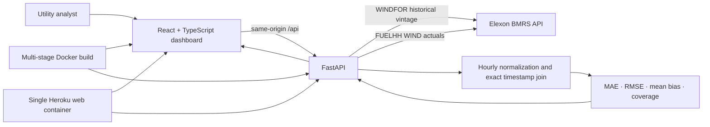

# Architecture

The browser never calls Elexon directly. FastAPI owns upstream timeouts, bounded retries, 15-minute in-memory response caching, timezone handling and schema normalization. The analysis module receives only Elexon observations, aggregates two half-hour actual MW records into an hourly mean when both are present, joins on exact UTC target time and calculates metrics from complete pairs. The React view exposes the published vintage and cutoff used for every daily result.

## Design / operating assumptions

January 2026 is GMT in the `Europe/London` timezone. The dashboard default 11:00 preceding-day decision cutoff is a pilot assumption and remains adjustable. WINDFOR historical hourly values are compared to actual hourly averages derived from the same one-hour window. Missing source values remain missing. A positive signed error means forecast exceeded actual. The dashboard measures forecast performance; it does not calculate demand balance, purchase volumes, prices or thermal dispatch requirements.
